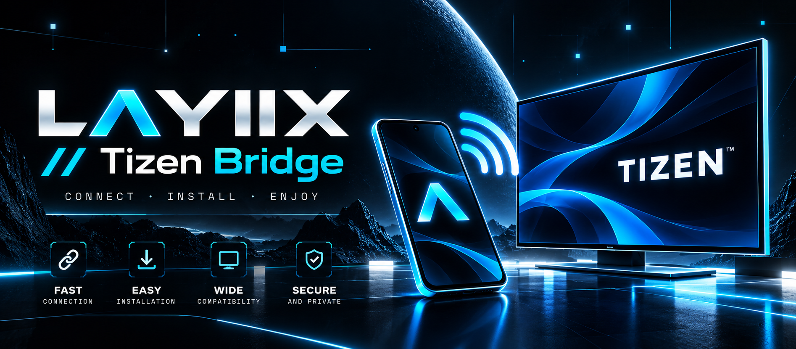

# LΛYIIX // Tizen Bridge



**CONNECT. INSTALL. ENJOY.**

Tizen Bridge installs Tizen packages (`.wgt` / `.tpk`) on Samsung Smart TVs straight from an Android phone over Wi-Fi. No PC, no Tizen Studio, no cables.

> **Beta status.** So far the app has been tested on one TV only: the author's Samsung UE50TU7170 (2020, Tizen 5.5). Everything else in [COMPATIBILITY.md](COMPATIBILITY.md) is marked **Untested** — it may work, or the TV may refuse at its own checks. If you try another model, please report how it went with the [bug report template](.github/ISSUE_TEMPLATE/bug_report.yml).

What this app does not do: it installs apps *onto* Tizen. It cannot install the Tizen operating system itself, and it does nothing for TVs that don't run Tizen (LG webOS, Android TV, pre-2015 Samsung Orsay). The first-run wizard blocks installation on those platforms and says why.

## Watch it work (58 seconds)

<video src="https://github.com/dev-layiix/layiix-tizen-installer/releases/download/v1.11.1/demo-connect-install.mp4" width="270" controls></video>

Recorded on a real phone against the test TV. The TV's IP goes into the *TV* tab (*Scan network* finds the set too), status flips to ONLINE, then a `.wgt` gets picked in *Install*, confirmed, uploaded, verified. The clip closes on the Home tab with the TV still connected. ([Download the video](docs/demo-connect-install.mp4) if it won't play here.)

## First-time setup

1. On the TV, open *Apps* and press `1 2 3 4 5` on the remote. Switch *Developer Mode* on.
2. Set the *Host IP* to the phone's Wi-Fi address. The app shows it under *More → Diagnostics*.
3. Hold Power for 5 seconds to reboot the TV, then accept the connection prompt on screen.

## Connecting

Open the *TV* tab and enter the TV's IP address (port defaults to `26101`), or run *Scan network*. The status card reads *ONLINE* only after a real SDB handshake succeeds. The phone and the TV must stay on the same Wi-Fi network.

## Everyday installs

Pick the *Catalog* tab for a one-tap download from 38 verified community apps, or *Install* to choose a local `.wgt` / `.tpk` file. Every package is validated before upload (extension, ZIP integrity, manifest, app ID, required Tizen version against the connected TV) and signed when needed. The app reports what the TV answers, including the raw installer output when something fails.

## Install the APK

Download: **https://workspace.layiix.com/layiix-tizen-installer.apk**

Open the link on the phone and confirm. Android asks once to allow installs from unknown sources. (Android 8.0+, no account needed.)

## Languages and privacy

Five interface languages (English, Italian, Spanish, Portuguese, Russian), taken from the system and overridable in Settings. No account, no analytics, no uploads — logs and diagnostics stay on the phone.

## Build from source

Prerequisites: JDK 17 or newer (tested with Temurin 21), Android SDK with platform 35 and build-tools 35.0.0. The Gradle wrapper downloads Gradle 8.7 on its own.

```bat
cd layiix-tizen-installer
gradlew.bat assembleDebug
```

APK output: `app\build\outputs\apk\debug\app-debug.apk`

Unit tests (52, JVM-only, no device needed):

```bat
gradlew.bat testDebugUnitTest
```

Release builds are signed with a local keystore (`keystore/` + `keystore.properties`, intentionally not committed — see [SECURITY.md](SECURITY.md)). How a release is cut is documented in [docs/RELEASING.md](docs/RELEASING.md).

## Troubleshooting

| Symptom | Likely cause | Fix |
|---|---|---|
| Closed port / timeout | Developer Mode off, wrong IP | Follow the in-app guide on the TV tab |
| Handshake refused | Authorization prompt ignored | Accept it on the TV screen |
| Error -11 (signature) | Package unsigned | The app signs automatically with bundled community certificates, or import your own under Settings → Signing |
| Error -12 (certificate) | Certificate issued for another TV (DUID) | Use a package signed for this TV |
| Error 116 | TV storage full | Settings → Support → Device Care → Manage Storage, then retry |
| Error -14 | Partner/platform privileges | Can't be sideloaded; pick a compatible app |
| Install "unconfirmed" | TV didn't register the app | Reboot the TV, free some space, retry |

## Known limits

- Signature checks run on the TV, not in the app. Bundled community certificates cover the catalog; packages tied to another TV's DUID still need their own certificate.
- Files are held in memory during upload (phone-side cap of 250 MB).
- LAN auto-scan is best-effort; some networks block it, so manual IP entry stays available.

## Stack

Kotlin, Jetpack Compose (Material 3), coroutines. The SDB client and Tizen package signing (XMLDSig) are implemented in-app; unit tests cover the pure logic (protocol framing, validation, signing, error mapping). Third-party code and assets are attributed in [NOTICE](NOTICE).

## License / credits

Own code: MIT (see `LICENSE`). Built by [LΛYIIX](https://layiix.com).
